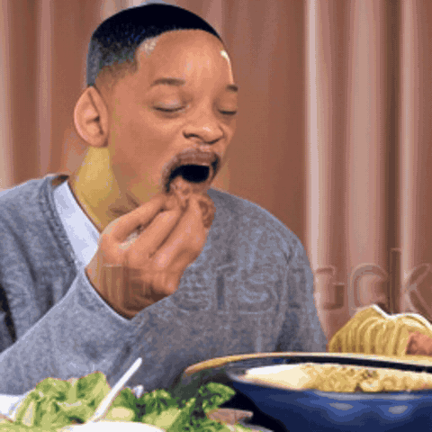
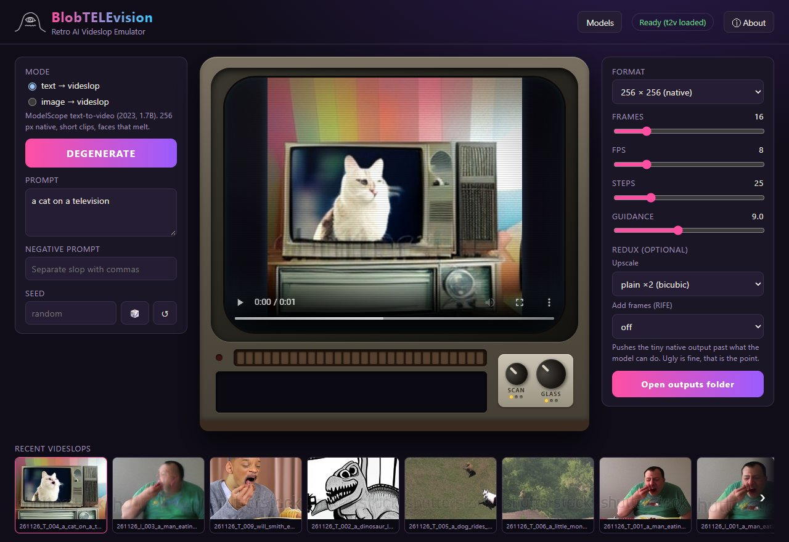
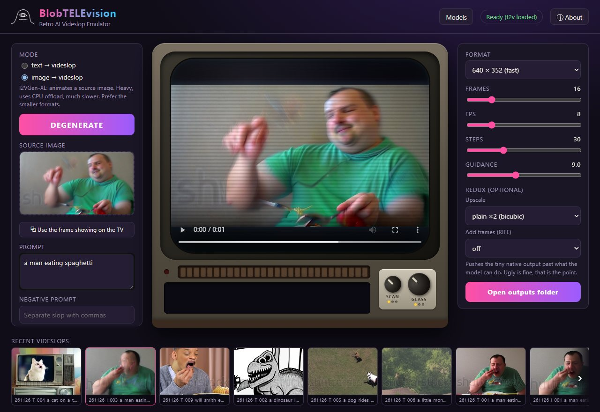
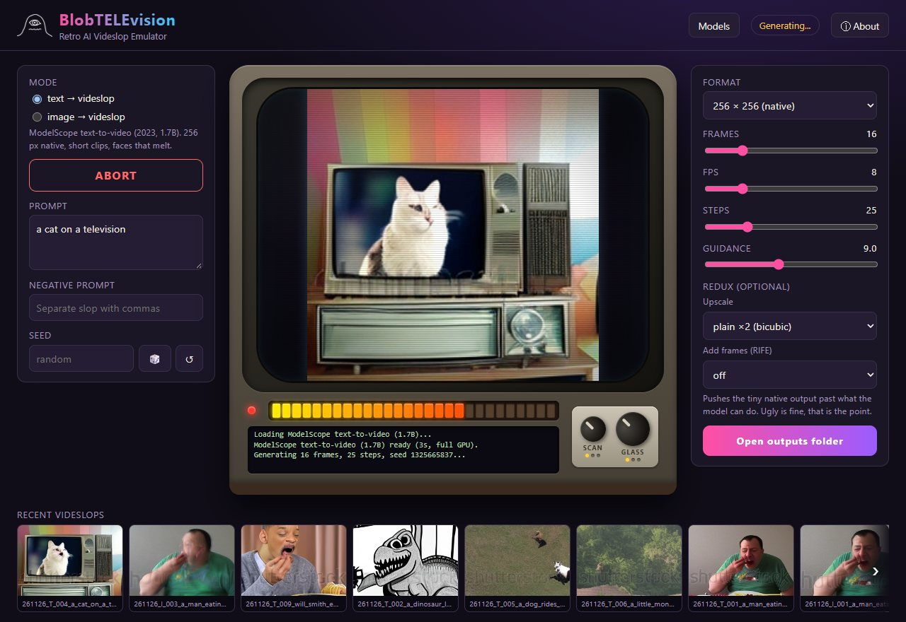
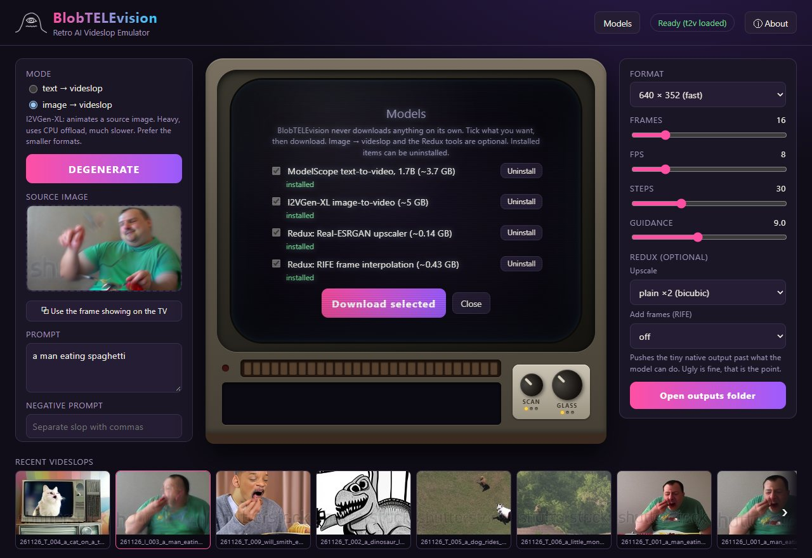

# BlobTELEvision


**Retro AI video slop emulator.** The little brother of [BlobVision](https://github.com/Nosferatumiamor/BlobVision).

Remember the first AI videos? The ones where everyone was eating spaghetti with a face that had clearly
given up on being a face? BlobTELEvision brings that back, on purpose, on your own GPU, with no account, no
credits and no filter between you and the slop.

<p align="center">
  
  <br />
  <sub>A real BlobTELEvision output, text to videslop, 256 x 256, two seconds. <a href="assets/demo-spaghetti.mp4">Watch the mp4</a>.</sub>
</p>

## What it does

BlobTELEvision runs the **original early generative-video models**, not a modern one pretending to be old.
They are the ones that made the internet howl in 2023, back when a clip of a man eating noodles that melted
into the table counted as a technological breakthrough:

- **ModelScope text-to-video (1.7B, DAMO Academy, March 2023)**: the first open text-to-video model most
  people ever touched, and the one behind the original "Will Smith eating spaghetti" meme. Trained at
  256 px, so it comes with the wobble, the melting faces and, if you are lucky, a ghostly stock-photo
  watermark that it learned along with everything else.
- **I2VGen-XL (Alibaba, late 2023)**: an optional second model that does **image to video**: give it a
  picture and it animates it, with all the confidence of a model that has never seen a hand.

Everything runs **offline, on your machine**. There is no server, no API and no account. The app forces the
Hugging Face libraries into offline mode, so once the weights are on your disk nothing is ever fetched behind
your back. The only network traffic is the one-time downloads you ask for (the Python environment on first
launch, then the model weights when you tick them).

On top of the historic models there is an optional **Redux** stage, because a 256 px clip with 16 frames is
a bit sad: Real-ESRGAN upscaling (x2 or x4) and RIFE frame interpolation (x2 or x4 frames *and* fps, so the
clip keeps its duration). Ugly is allowed, that is the point.



*The interface is a 1990s TV. The two big knobs on the front switch the **SCAN** (scanlines, rolling bar,
jitter) and **GLASS** (glow, vignette, glare) CRT effects, both off by default. The row of slats under the
screen is the progress bar, and the little red LED is on whenever the engine is busy.*

## How to use it

> **Warning.** The **first** launch builds a whole Python environment (several GB, mostly PyTorch), so it is
> slow. The installer itself is tiny: it only contains the app, everything else is downloaded when you first
> open it, and you can follow it live on the TV screen. Every launch after that is much quicker.

1. Install and launch.
2. The app asks which model weights you want. Text to video is about 3.7 GB, image to video about 5 GB more.
   Nothing is downloaded without you ticking it. The **Models** button in the header brings the panel back
   whenever you want to add or uninstall one.
3. Write a prompt, hit **DEGENERATE** (or just press Enter in the prompt box). A 16 frame clip at the native
   size takes well under a minute on a decent GPU.

Tips:

- Short, simple prompts work best. "a man eating spaghetti" is a classic for a reason.
- 256 x 256 is the native size and the most authentic one. Bigger formats work but look less like 2023.
- The screen tells you what the engine is doing, including when it swaps one model for the other (only one
  model sits on the GPU at a time), with a seconds counter so you can tell "slow" from "stuck".
- **Fast reboot** (header) keeps the engine alive for 30 minutes after you close the window, so reopening is
  instant. Untick it if you are done for the day: closing the app then stops everything.
- Every video is saved in the outputs folder (button on the right), and the generation parameters (prompt,
  seed, steps, format...) are written **inside the video's own metadata** (title = prompt, comment = full
  JSON, see Properties > Details in Explorer). No sidecar file, and you can always reproduce a result.

### Image to videslop

Switch the mode to **image to videslop** and give the model a picture to animate. There are three ways to do it:

1. **Click** the *Source image* box and pick a file.
2. **Drag and drop** an image from your desktop onto the box. You can actually drop it **anywhere on the
   window**: if you were in text to videslop, the app switches to image mode for you.
3. **Start from a frame of a video you already generated.** Click any videslop on the shelf at the bottom: it
   plays on the TV. Pause it and scrub with the player bar to the exact frame you want, then click
   **Use this frame** (it appears on the screen when you hover it) or **Use the frame showing on the TV**
   under the source box. The frame is captured at full size, becomes the source image and the app switches
   to image mode. Hit **DEGENERATE** and the model animates that frame. Chain it as many times as you dare:
   clip, frame, new clip, frame, new clip, each one a little more cursed than the last.



I2VGen-XL is heavy: it always runs with CPU offload and has a VRAM cliff, so the app caps the number of
frames automatically from the format and your VRAM (larger formats are flagged "NEEDS STRONG GPU"). Redux
interpolation is the way to add frames back.

### Watching it work



*During a generation the speaker grille fills from yellow to red, the LED lights up, a small console sits in
the TV frame, and for text to video the image emerges live on the screen.*

### Models



*Pick what you want, see what is installed, uninstall à la carte. Weights live in the `models/` folder next to
the app.*

## Hardware and requirements

- Windows, with an NVIDIA GPU and up-to-date drivers. Tested on an RTX 3060 (12 GB) with 32 GB of RAM.
  Feel free to try other hardware and share your results.
- Disk: a few GB for the Python environment, plus the models you choose.
- Other platforms: none is planned, at least for the moment. Feel free to create a fork for those systems.

## Building from source

```
Build-Installer.bat     # exe + NSIS installer under tauri/src-tauri/target/release/bundle/nsis/
```

It needs Node.js and Rust (MSVC toolchain). The script removes the compiled Python caches, strips the build
machine's user name and paths out of the exe, and fails if it still finds any of them. A plain
`npm run tauri build` from `tauri/` also works but skips those two steps, so do not publish its output.

For development use `BlobTELEvision-Dev.bat` (it recompiles on every launch; the console shows the build and
closes itself once the window opens, the log is in `logs/dev.log`). See `CLAUDE.md` for the architecture notes.

## About AI and Vibe Coding

This project was imagined by GROM and built with the help of AI (vibe coding, with Claude by Anthropic). It
works on my machine and I test it, but it comes with no guarantee whatsoever.

## License and disclaimer

BlobTELEvision's own code is released under the [MIT license](LICENSE). The models and libraries it downloads
keep their own licenses, listed in [THIRD-PARTY-NOTICES.md](THIRD-PARTY-NOTICES.md). **The ModelScope model
is licensed for non-commercial use only.**

The models are unfiltered and can produce anything, including things that are weird, ugly or offensive. You
are responsible for what you generate and what you do with it. Do not use it to impersonate or harm real
people. Model weights are downloaded from their authors' repositories (Hugging Face): please read their licenses.
