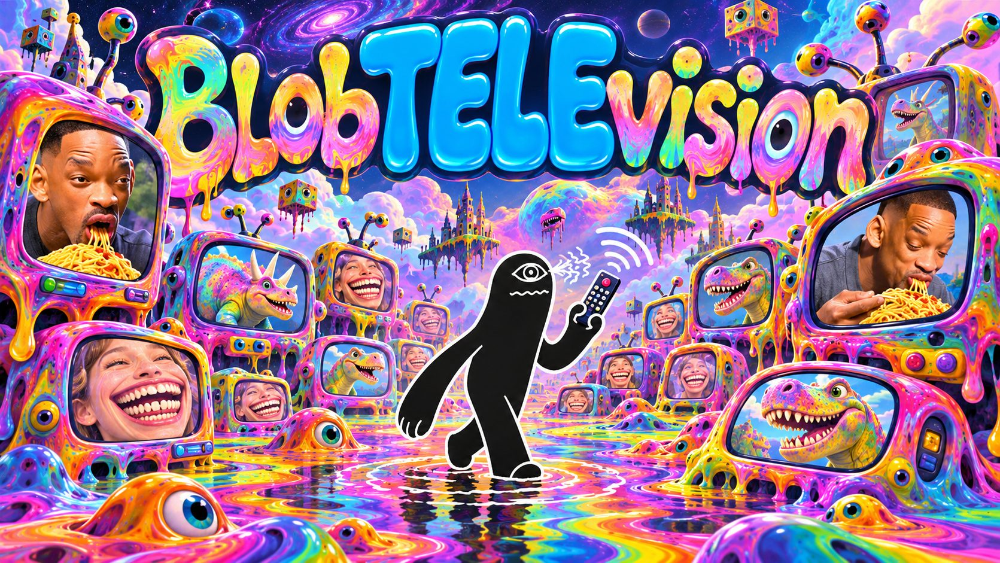

# BlobTELEvision



**Retro AI video slop emulator.** The little brother of [BlobVision](https://github.com/Nosferatumiamor/BlobVision).

Remember the first AI videos? The ones where everyone was eating spaghetti with a face that had
clearly given up on being a face? BlobTELEvision brings that back, on purpose, on your own GPU,
with no account, no credits and no filter between you and the slop.

It runs the original early-2023 models, not a modern one pretending to be old:

- **Text to video**: ModelScope text-to-video (the 1.7B DAMO model). Trained at 256 px, so it comes with
  the wobble, the melting faces and, if you are lucky, a ghostly stock-photo watermark.
- **Image to video**: I2VGen-XL, an optional second model that animates a picture you give it.

Everything is local. Nothing leaves your machine except the one-time model download.

## How to use it

1. Install and launch. Be warned: the **first** launch downloads a whole Python environment (several GB,
   mostly PyTorch), so it is slow. Every launch after that is much quicker.
2. The app then asks which model weights you want. Text to video is about 3.7 GB, image to video about 5 GB
   more. Nothing is downloaded behind your back.
3. Write a prompt, hit **DEGENERATE**. A 16 frame clip at the native size takes well under a minute on a
   decent GPU.

Tips:

- Short, simple prompts work best. "a man eating spaghetti" is a classic for a reason.
- 256 x 256 is the native size and the most authentic one. Bigger formats work but look less like 2023.
- **Redux** (optional, off by default except a plain x2 resize): the model is tiny on purpose, so you can push
  the result past what it can really do. **Upscale** can use Real-ESRGAN x2 or x4, and **Add frames** uses
  RIFE to insert frames between the real ones (x2 or x4 frames *and* fps, so the clip keeps its duration).
  Ugly is allowed, that is the point. These tools are a small one-time download, asked for only when you
  pick an option that needs them (Real-ESRGAN about 140 MB, RIFE about 430 MB to download, much less on disk).
- The generation parameters (prompt, seed, steps, format...) are saved inside every video's metadata (title = prompt, comment = full JSON; see Properties > Details in Explorer), so you can reproduce a result without any extra file.
- **Fast reboot** keeps the models loaded for 30 minutes if you closed the program by accident.

## Hardware and requirements

- Windows, with an NVIDIA GPU and up-to-date drivers. Tested on an RTX 3060 (12 GB) with 32 GB of RAM.
  Feel free to try other hardware and share your results.
- Disk: a few GB for the Python environment, plus the models you choose.
- Other platforms: none is planned, at least for the moment. Feel free to create a fork for those systems.

## Building from source

```
cd tauri
npm install
npm run tauri build     # exe + NSIS installer under src-tauri/target/release/
```

For development use `BlobTELEvision-Dev.bat`. See `CLAUDE.md` for the architecture notes.

## About AI and Vibe Coding

This project was built with the help of AI (vibe coding). It works on my machine and I test it, but
it comes with no guarantee whatsoever.

## Disclaimer

The models are unfiltered and can produce anything, including things that are weird, ugly or offensive.
You are responsible for what you generate and what you do with it. Do not use it to impersonate or harm
real people. Model weights are downloaded from their authors' repositories (Hugging Face) and keep their
own licenses; please read them.
